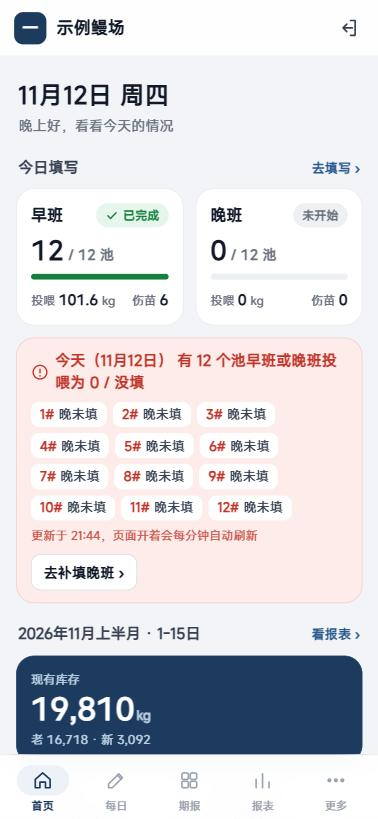
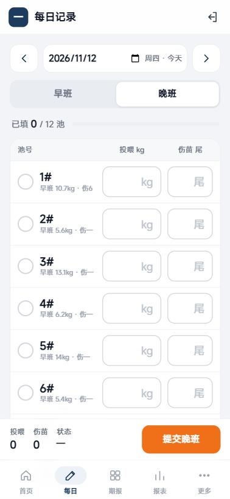
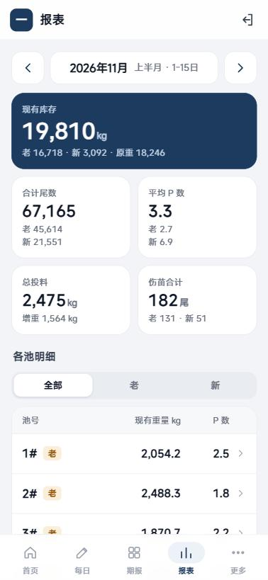

# 養鰻場の帳票Webシステム（ポートフォリオ用の公開版）

前職の養鰻場で Excel で作っていた在庫・投餌の帳票を、スマートフォンで入力できる Web システムにしたものです。

> **この公開版について**
> - 実際の現場向けに作ったシステムから、帳票機能の部分だけを取り出したものです。
> - 養鰻場の名前、サーバーの設定、パスワード、実際のデータはすべて削除・置き換えています。画面の数字はすべて架空のサンプルデータです。
> - 使う人が中国語話者のため、画面は中国語です。

## 開発の進め方（正直に書きます）

コードの大部分は AI コーディングツール（Claude Code・Codex）が書きました。私が担当したのは次の部分です。

| 担当 | 内容 |
|---|---|
| 要件の整理 | 現場の Excel の計算式（増重、平均サイズなど）や、誰がいつ何を入力するかを整理し、AI に伝えた |
| 動作確認・テスト | 同じデータを入れて、元の Excel と計算結果が一致するかを確認した。自動テストの結果も毎回確認した |
| 公開・運用 | サーバーへの公開、バックアップの手順を整えた |

## 画面

| ホーム | 毎日の入力 | 帳票 |
|---|---|---|
|  |  |  |

- **ホーム**：今日の朝・晩の入力状況と、入力漏れの池が一目でわかる
- **毎日の入力**：池ごとに投餌量（kg）と減耗数（尾）を入力
- **帳票**：在庫重量、尾数、平均サイズ（P数）を半月ごとに集計し、池ごとの明細も見られる

## 主な機能

- 従業員がスマートフォンで朝晩の投餌量と減耗数を入力
- 半月ごとの帳票を自動計算（前の期の数字を自動で引き継ぎ）
- A4 印刷用の Excel 出力
- 既存の Excel の取り込み（内容をプレビューで確認してから登録）
- 管理者・経営者でパスワードを分け、見られる画面を区別
- 複数の養殖場のデータを別々のデータベースで管理

## 計算ルール（元の Excel と同じ）

- 増重 ＝ 投餌量 × 転換率
- 現在の重量 ＝ 元の重量 ＋ 増重
- 現在の尾数 ＝ 元の尾数 − 減耗数
- P数（1kg あたりの尾数）＝ 現在の尾数 ÷ 現在の重量（小数点以下 1 桁で切り捨て）

## 使用技術

Python（FastAPI）／SQLite／openpyxl（Excel 出力）／HTML・CSS・JavaScript

## 動かし方（Windows）

```powershell
python -m venv .venv
.\.venv\Scripts\python -m pip install -r requirements.txt
$env:DATA_DIR = "$PWD\.demo-data"
.\.venv\Scripts\python -m tools.seed_demo        # 架空のサンプルデータを作る
$env:APP_PASSWORD = "demo-admin"
.\.venv\Scripts\python -m uvicorn app.main:app --port 8100
```

ブラウザで http://127.0.0.1:8100 を開き、`demo-admin` でログインします。

## テスト

```powershell
.\.venv\Scripts\python -m unittest discover -s tests
```

計算、期間の引き継ぎ、Excel の取り込みと出力、給与計算、ログインとアクセス制御などのテストが 55 件あります。
